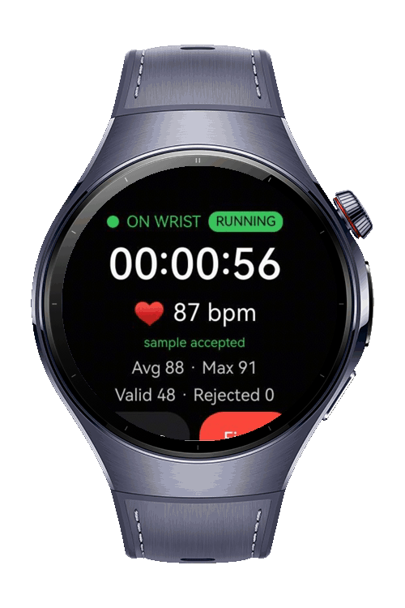
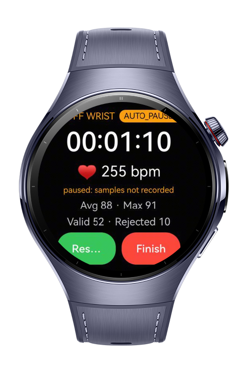
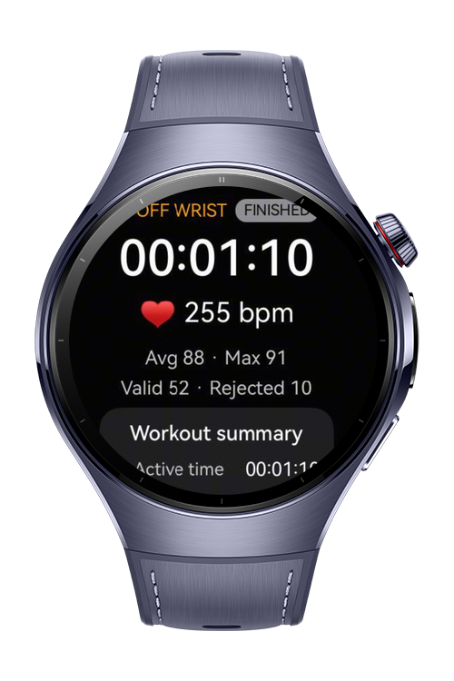

> **Note:** To access all shared projects, get information about environment setup, and view other guides, please visit [Explore-In-HMOS Index](https://github.com/Explore-In-HMOS/hmos-index).

# How to Use Wear Detection for Workout Data Validation on HarmonyOS Wearable

This HarmonyOS wearable sample shows how to use the `WEAR_DETECTION` sensor to validate workout data. During a workout, the app monitors if the watch is on the wrist. When the watch is not on the wrist, the app rejects heart rate samples. When the watch stays off the wrist for a set time, the app pauses the workout automatically. When the workout ends, the app removes all sensor subscriptions.

# Preview

<div>
  
  
  
</div>

# Use Cases

- Subscribe to the `WEAR_DETECTION` sensor with `@ohos.sensor` when a workout starts
- Reject heart rate samples when the watch is not on the wrist
- Reject heart rate samples for 5 seconds after the user puts the watch back on
- Show a warning and vibrate when the user removes the watch
- Pause the workout automatically after the watch is off the wrist for a set time
- Unsubscribe from all sensors when the workout ends

# Technology

## Stack

- **Languages**: ArkTS, ArkUI
- **Frameworks**: HarmonyOS Stage Model
- **Tools**: DevEco Studio, Hvigor
- **Libraries**:
	- `@kit.SensorServiceKit` (`sensor`, `vibrator`)
	- `@kit.AbilityKit` (`UIAbility`, `abilityAccessCtrl`)
	- `@kit.ArkUI`
	- `@kit.PerformanceAnalysisKit` (`hilog`)

## Required Permissions

- ohos.permission.READ_HEALTH_DATA
- ohos.permission.VIBRATE

## Workout States

```
IDLE ──Start──> RUNNING <──Pause / Resume──> PAUSED
                   │  ^
   watch off for   │  │ watch back on (auto resume)
   the set time    v  │ or Resume
                AUTO_PAUSED
RUNNING / PAUSED / AUTO_PAUSED ──Finish──> FINISHED ──New workout──> IDLE
```

- The active time increases only in the `RUNNING` state.
- In `PAUSED` and `AUTO_PAUSED`, the app does not record heart rate samples.
- The app records how many times the user removed the watch, and the total time off the wrist.

## Sample Validation

`SampleFilter` examines each heart rate sample in the `RUNNING` state:

| Condition | Result |
|---|---|
| The value is 0 or less | Rejected: invalid value |
| The watch is not on the wrist | Rejected: watch not worn |
| Less than 5 seconds after the user put the watch back on | Rejected: warm-up |
| All other samples | Accepted |

Only accepted samples go into the average and the maximum heart rate.

## Watch Removal

1. The user removes the watch during a workout.
2. The watch vibrates. A yellow banner shows "Watch removed · pausing in N s".
3. If the user puts the watch back on before the countdown ends, the countdown stops.
4. If the countdown ends, the state changes to `AUTO_PAUSED`. The watch vibrates again.
5. When the user puts the watch back on:
   - If **Auto resume** is on, the workout continues.
   - If **Auto resume** is off, a blue banner asks the user to resume. Tap **Resume**.

## Settings

| Setting | Function |
|---|---|
| Auto-pause after | Sets the countdown to 5, 10, or 30 seconds. The default is 10 seconds. |
| Auto resume | Continues the workout automatically when the user puts the watch back on |
| Simulated sensors | Uses simulated wear and heart rate data. You can change it only when no workout runs. |
| Active subscriptions | Shows the number of sensor subscriptions. After **Finish**, it must be 0. |

# Directory Structure

```
entry/
|   src/
|       main/
│   module.json5
│
├───ets
│   ├───common
│   │       Constants.ets
│   │       Format.ets
│   │       Logger.ets
│   │
│   ├───entryability
│   │       EntryAbility.ets
│   │
│   ├───model
│   │       SampleFilter.ets
│   │       WearState.ets
│   │       WorkoutSession.ets
│   │
│   ├───pages
│   │       Index.ets
│   │
│   └───service
│           Haptics.ets
│           HeartRateSource.ets
│           WearStateMonitor.ets

```

# Constraints and Restrictions

## Supported Device

- Huawei Watch 5

## Notes

- The `WEAR_DETECTION` sensor gives 1 when the watch is on the wrist and 0 when it is not.
- Until the first wear event comes, the app thinks that the watch is on the wrist.
- The sample does not use a continuous task. When the app goes to the background, the system can suspend it. For long workouts, add a continuous task from `@kit.BackgroundTasksKit`.

# License

**How to Use Wear Detection for Workout Data Validation on HarmonyOS Wearable** is distributed under the terms of the MIT License. See the [LICENSE](LICENSE) for more information.
